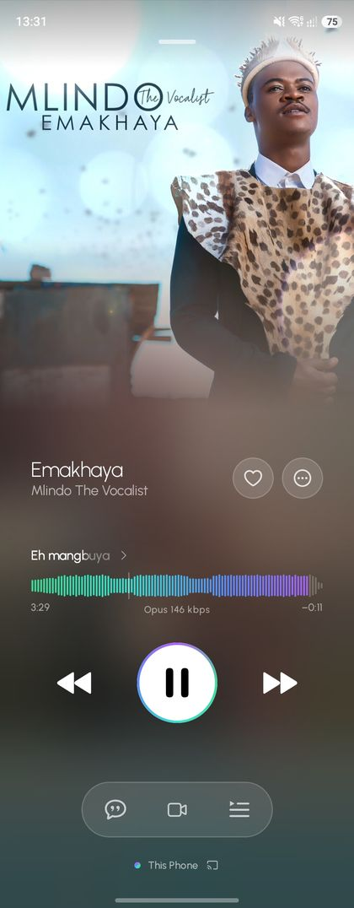
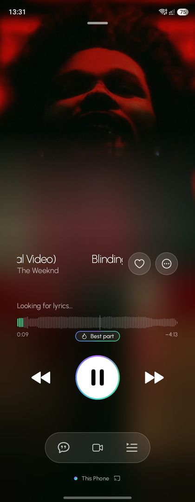
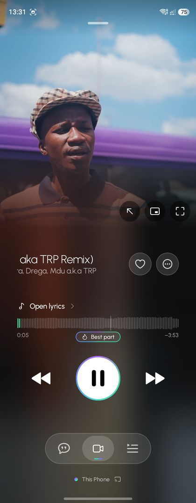
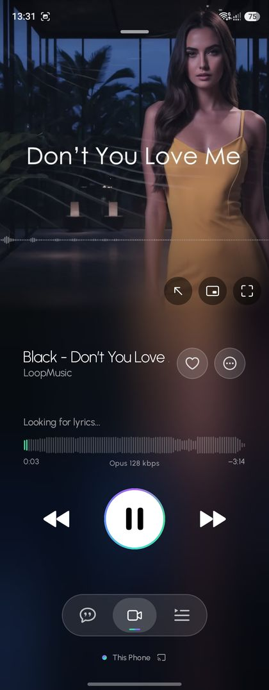
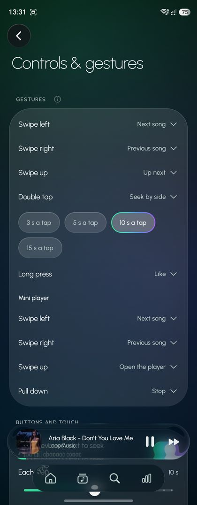
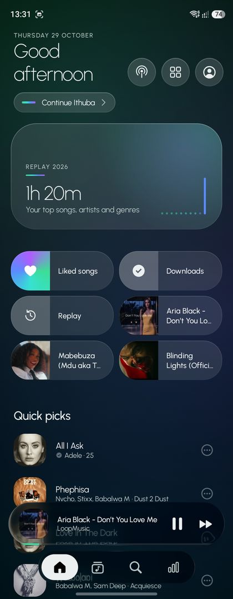
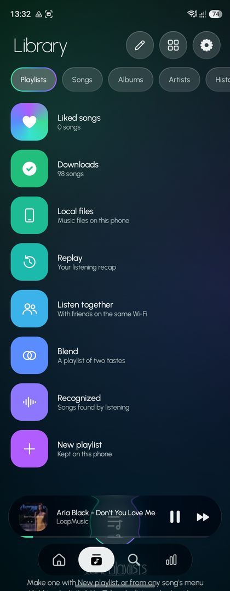
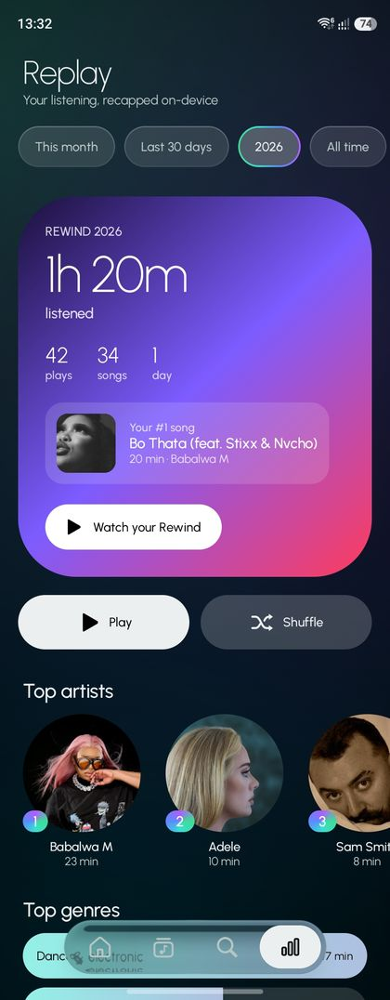
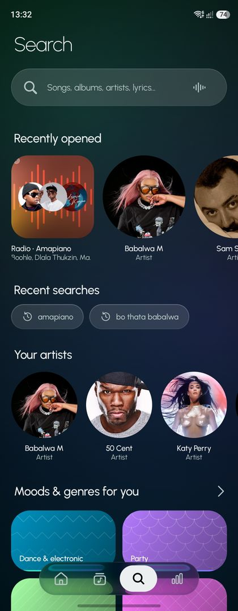
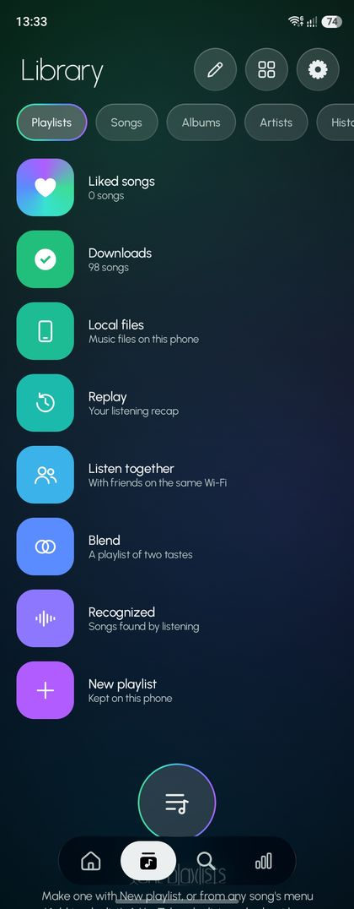

<div align="center">

# 🎧 VINZ

### A community-built Android client for YouTube Music

**Independent. Unofficial. Built in the open under the GNU GPL.**

<br />

<a href="https://github.com/nastechtest/Vinz">
  
</a>
<br />
<a href="https://www.gnu.org/licenses/gpl-3.0.html">
  
</a>


<br /><br />

[Overview](#-what-vinz-is) •
[Screenshots](#-a-look-inside) •
[**Looks & Themes**](#-looks--themes) •
[Build](#-getting-started) •
[Testing](#-testing) •
[Releases](#-releases-and-apk-signing) •
[Contributors](#-contributors) •
[**License**](#-license--gnu-gpl-v30-or-later)

</div>

---

## 🖼️ A look inside

<div align="center">













<sub>Vinz running on Android — every screen in the app is themed by the Look in use.</sub>

</div>

---

## 📖 What Vinz is

**Vinz** is an unofficial Android client for YouTube Music.

It began as a fork of the open-source Android music client by **Yigder** and has since been developed independently —
there is no upstream remote, and no upstream sync anywhere in its history. The lineage is kept in the credits and the
notices, as the GPL requires.

The project keeps what makes a music client good — fast navigation, a player that gets out of the way, lyrics that
keep up — and puts the *look* of the app in your hands. Vinz's own contribution is its **Looks** system: a whole
appearance is a single named, shareable object, and changing it is one edit rather than a hundred switches.

Vinz is not affiliated with, endorsed by, or sponsored by Google or YouTube.

> [!IMPORTANT]
> Vinz is an unofficial third-party client. YouTube, YouTube Music, and Google are trademarks of their respective
> owners. This project does not claim ownership of their services, branding, or content.

---

## 🎨 Looks & Themes

A **Look** is a named snapshot of how Vinz looks: theme and accent, light and glass, backgrounds, type, corners,
spacing, the player, the lyrics — plus an icon style and, if you like, your own font. Applying one is a single edit,
so the app redraws once. Undo names what changed in words (`Corners → Sharp`), and every Look can be shared as a code
that fits in a QR code.

### Built into Vinz

<div align="center">

| Look | What it is |
|:--|:--|
| **Vinz** | How Vinz comes: Outfit, the split light, soft corners |
| **Paper** | Light, serif type, ink instead of color, warm paper |
| **Midnight** | Pure black, thin icons, a deep blue |
| **Neon** | Mono type, neon light, sharp corners |
| **Soft** | Rounded type, extra-round corners, pastels |
| **Studio** | White light, no accent, compact, classic controls |
| **Vinyl** | A record on the player, warm amber, serif titles |

</div>

### From the community

Shared Looks live in [`themes/`](themes/) and appear in the app under **Settings → Appearance → Looks → From the
community**. Vinz only downloads the list when you open it, and a Look's file only when you use it — and a Look can
only ever change how Vinz looks, never accounts or playback.

<div align="center">

| Look | By | What it is |
|:--|:--|:--|
| **Aurora Glass** | Yigder | Liquid Glass over drifting aurora, airy type |
| **Graphite** | Yigder | Ink on graphite, compact, a docked tab bar |
| **Sunset Drive** | Yigder | A dusk horizon, warm light, ringed controls |
| **Forest Walk** | Yigder | Light, serif, contour lines in green |
| **Nothing** | ZeroxDev | A Nothing-themed look, light and modern |

</div>

### Share a Look

Looks travel as text — `VINZLOOK1:` and the Look deflated, small enough for a QR code when it carries no photo or
font of its own. Codes are filtered on import: only look settings, each with the right kind of value, and backgrounds
that are designs or kept photos — never a path on someone else's phone.

Want yours listed in the app? See [`themes/README.md`](themes/README.md) — save the Look, copy its share code, add an
entry to [`themes/index.json`](themes/index.json), and open a pull request. `ThemeGalleryTest` checks every entry.

---

## ✨ Features and scope

| Area | Project scope |
|:--|:--|
| Android application | Native Android project |
| Music service | YouTube Music |
| Application identity | `com.vinz.music` |
| Appearance | Looks: named, shareable, importable app-wide themes |
| Development | Local Gradle builds |
| Quality assurance | Unit tests and automated CI checks |
| Integration testing | Some tests communicate with live music or lyrics endpoints |
| Licensing | GPL-3.0-or-later |
| Source attribution | Retains applicable upstream copyright and component notices |

This table describes the project's established scope and development setup; it is not a claim that every possible
YouTube Music feature is implemented.

---

## 📋 Project at a glance

| Property | Details |
|:--|:--|
| Project name | Vinz |
| Platform | Android |
| Application ID | `com.vinz.music` |
| Kotlin namespace | `com.vinz.music` |
| Language | Kotlin |
| Build system | Gradle |
| Version | [`version.properties`](version.properties) — currently `1.7.7.1` (`versionCode` 47) |
| License | GNU GPL-3.0-or-later |
| Upstream attribution | Yigder and original component authors |
| Repository | [`nastechtest/Vinz`](https://github.com/nastechtest/Vinz) |
| Distribution | Build locally or use a project-published release when available |

---

## 🚀 Getting started

There are two main ways to work with Vinz:

- **Build from source** — compile the application yourself.
- **Run the tests** — check the local unit-test suite before making or contributing changes.

### Prerequisites

| Requirement | Version or configuration |
|:--|:--|
| Java Development Kit | JDK 17 or newer |
| Android SDK platform | API 37 |
| Android SDK command-line tools | Required |
| Gradle | Use the repository's Gradle Wrapper |
| Network connection | Recommended for dependencies; required for live endpoint integration tests |

The project's Gradle configuration remains the source of truth for the exact Android Gradle Plugin, Gradle, Kotlin,
and other dependency versions.

### 1. Clone the repository

```bash
git clone https://github.com/nastechtest/Vinz.git
cd Vinz
```

### 2. Build the debug APK

```bash
./gradlew :app:assembleDebug
```

On a successful build, Gradle normally writes the debug APK to:

```
app/build/outputs/apk/debug/app-debug.apk
```

### 3. Install on a connected Android device

Enable USB debugging, connect the device, and verify ADB can see it:

```bash
adb devices
```

Then install:

```bash
adb install -r app/build/outputs/apk/debug/app-debug.apk
```

Alternatively, open the project in Android Studio, let Gradle synchronize, select the `app` configuration, and run it.

> [!NOTE]
> Debug builds are intended for development and testing. They are not substitutes for properly signed production
> releases.

---

## 🧪 Testing

```bash
./gradlew :app:testDebugUnitTest
```

| Task | Command | Purpose |
|:--|:--|:--|
| Build debug APK | `./gradlew :app:assembleDebug` | Compile the debug application |
| Run unit tests | `./gradlew :app:testDebugUnitTest` | Execute the configured debug unit tests |
| Run build and tests | Both commands above | Check compilation and unit-test results |

### Network-dependent tests

Some test classes communicate with live YouTube Music or lyrics endpoints. They may need an active internet connection
and can be affected by remote service availability or changes. The required CI test set excludes them; a passing
offline CI run does not necessarily mean every live integration test has passed.

---

## ⚙️ Continuous integration

Three pipelines cover the three kinds of build. Full details, including recovery steps, are in the
[release guide](docs/RELEASING.md).

| Event | Automation |
|:--|:--|
| Pull request opened or updated | Android Lint, the deterministic unit tests, a debug APK, and an uploaded test build |
| Push to `main` | The same checks, then a development build numbered from the commit count |
| *Release* run (`patch` / `minor` / `major`, `preview` / `stable`) | The version is worked out, the build signed and tagged, and the release published after one approval |

The checks that gate a merge are **Validate Gradle wrapper**, **Lint**, **Unit tests and debug build**, and
**Analyze (java-kotlin)**.

### Unit tests in CI

The 20 test classes whose names contain `Live` or `ApiTest` call real YouTube Music and lyric endpoints. They are
excluded from CI because they fail whenever a remote service is slow or changes its output. The remaining 91 test
classes run on the JVM and do gate a merge.

### Three apps, one per channel

Vinz builds as three separate apps that install side by side, each updating itself from its own channel — so a pull
request, `main` and a stable release can all be on the same phone at once:

| App | Package | Built from | Updates from |
| --- | --- | --- | --- |
| **Vinz** | `com.vinz.music` | a stable release | `/releases/latest` |
| **VinzM** | `com.vinz.music.main` | every push to `main` | the rolling `main-latest` prerelease |
| **VinzP** | `com.vinz.music.pr` | every push to a pull request | that PR's rolling `pr-<number>` prerelease |

Each app offers its own updates in Settings → About and in the banner on Home, and never offers another channel's
APK: a VinzP built from PR #16 only ever sees PR #16's builds, and Vinz only ever sees stable releases. They do not
share data — three installs mean three libraries.

`-Pchannel=pr|main|stable` decides which app a build is; the workflows pass it, and a local build without it is a
plain Vinz. Each channel build is stamped with its own rising `versionCode` (the stable code × 1000 plus the build
number), because Android refuses an APK whose code does not increase.

A pull request build also attaches the same APK to its workflow run:

```bash
gh run download <run-id> -n Vinz-PR-42-build-3 -R nastechtest/Vinz
adb install -r Vinz-PR-42-build-3.apk
```

### Development builds

Every push to `main` produces `Vinz-main-<version>-build-<n>.apk`, where `n` is the number of commits on `main`,
and refreshes the *Main — Latest* prerelease that VinzM updates from. These are development builds: they are not
tested beyond CI and are not stable releases.

---

## 📦 Releases and APK signing

Stable releases are never published automatically. A maintainer starts the **Release** workflow, chooses the bump and
the channel, and the workflow works out the version, builds it, signs it, tags it and publishes it. The signing key
is read only after the protected `stable-production` environment is approved, so an unapproved run publishes nothing
and creates no tag.

### Version source of truth

[`version.properties`](version.properties) holds `versionName` and `versionCode`, and is the floor a release is
computed from. Cutting a release is one dispatch — pick `patch`, `minor` or `major` and whether it is a `preview`
or a `stable` release — and the workflow works out the version, stamps the build, tags it and publishes it. The
released version and its `versionCode` are recorded on the tag, so a released version can never be handed out
twice.

### Release signing requirements

| Secret | Purpose |
|:--|:--|
| `ANDROID_KEYSTORE_BASE64` | Base64-encoded Android release keystore |
| `ANDROID_KEYSTORE_PASSWORD` | Password protecting the keystore |
| `ANDROID_KEY_ALIAS` | Alias identifying the signing key |
| `ANDROID_KEY_PASSWORD` | Password for the signing key |

The four secrets are only ever read by the `stable-release` workflow, after the approval gate. Pull request and main
workflows never receive them. The release workflow intentionally fails if its required signing secrets are absent, and
it rejects an APK signed with the Android debug key.

### Security requirements

- Keep keystore files and passwords out of Git.
- Never place signing credentials in source code, logs, or public workflow output.
- Use the same protected release key for subsequent updates to preserve Android signing continuity.
- Restrict access to repository secrets and release permissions.
- Never distribute a debug-signed APK as a production release.
- Verify the release artifact and its signature before publishing it.

### Obtaining a release

Visit the repository's [Releases page](https://github.com/nastechtest/Vinz/releases). For a build to try on your own
phone, download the *Main — Latest* prerelease or the artifact of any recent run. If no release is listed, build the
application locally using the instructions above.

---

## 🏗️ Contributing

Contributions that improve correctness, reliability, maintainability, testing, documentation, and compatibility are
welcome, subject to the project's contribution policies. See [`CONTRIBUTING.md`](CONTRIBUTING.md).

1. Fork the repository and create a dedicated branch.
2. Review the existing implementation before changing behavior.
3. Make focused changes that preserve upstream attribution and license obligations.
4. Run the relevant unit tests.
5. Build the Android application.
6. Review the final diff for unintended changes, exposed credentials, and generated files.
7. Open a pull request against `main`, describing the changes and the verification performed.

```bash
./gradlew :app:testDebugUnitTest
./gradlew :app:assembleDebug
```

Include any known limitations, network dependencies, and steps needed to reproduce a failure.

---

## 👥 Contributors

<div align="center">

| | Who | Work |
|:--|:--|:--|
| 🎧 | **Nastech Research** <br/> [@nastechresearch](https://github.com/nastechresearch) | Vinz — the identity and rebrand, the codebase as it stands today, the CI/CD pipelines, versioning, release signing, and this documentation |
| 🌱 | **Yigder** | The original open-source Android music client Vinz began from, and four community Looks: *Aurora Glass*, *Graphite*, *Sunset Drive*, *Forest Walk* |
| ✨ | **ZeroxDev** | The *Nothing* community Look |
| ⚖️ | **GNU Project / FSF** | The GNU General Public License Vinz is distributed under |
| 🤖 | **Dependabot** | Dependency updates |

</div>

Vinz began as a fork of Yigder's client and keeps his copyright and notices, as GPL-3.0 requires. The codebase has
since been developed independently of it. Please keep both the upstream notices and the license intact in any
redistribution.

---

## 📄 License — GNU GPL v3.0 or later

<div align="center">


**Vinz is free software, distributed under the
[GNU General Public License, version 3](https://www.gnu.org/licenses/gpl-3.0.html) or (at your option) any later
version.**

</div>

The full, unmodified license text ships with this repository in [`LICENSE`](LICENSE). It is the GNU General Public
License, version 3, 29 June 2007 — © 2007 Free Software Foundation, Inc., and it is distributed with this project
verbatim and unaltered. The license is credited to the **GNU Project** and the **Free Software Foundation**; it is not
a Vinz-specific license and must not be modified.

In short — this is a summary, not a substitute for the license:

| | |
|:--|:--|
| ✅ You may | Use Vinz for any purpose, study it, modify it, and redistribute it or your modified version |
| 📖 You must | Publish your changes under the same license, and keep the source available to anyone you distribute to |
| 🏷️ You must | Keep copyright notices, the `LICENSE` file, and third-party component notices intact, and state significant changes |
| 🚫 You may not | Sublicense Vinz under different terms, or distribute it without its source and this license |
| ⚠️ No warranty | Vinz comes with **no warranty**, to the extent permitted by law |

Because Vinz is distributed under the GPL, anyone who distributes a modified version must also make the complete
corresponding source available under the GPL. There is no separate "commercial" or proprietary edition.

**Copyright.** The code written for Vinz is © Nastech Research and the Vinz contributors, licensed under
GPL-3.0-or-later. Portions that descend from the client Vinz began from remain © Yigder and the original component
authors, under the same license. See [`FORK_NOTICE.md`](FORK_NOTICE.md).

Relevant files:

- [`LICENSE`](LICENSE) — the full GNU GPL v3 text
- [`FORK_NOTICE.md`](FORK_NOTICE.md) — fork and attribution notice
- [`CHANGELOG.md`](CHANGELOG.md) — record of significant changes

For the full terms, consult [`LICENSE`](LICENSE) or <https://www.gnu.org/licenses/gpl-3.0.html>.

---

## 🙏 Acknowledgements

- **Yigder** — for the original open-source Android client this project is built on, and for four of the community
  Looks.
- **ZeroxDev** — for the *Nothing* community Look.
- **The GNU Project and the Free Software Foundation** — for the GPL, and for the legal groundwork that makes
  community software like this possible.
- **The maintainers of every open-source component Vinz depends on** — Kotlin, AndroidX, Media3, Compose, and the rest.

Vinz builds on existing open-source work and aims to maintain that attribution as the project evolves.

---

## 🛡️ Privacy, security, and responsible use

Vinz is an unofficial third-party client. Interactions with YouTube Music and other remote services remain subject to
the behavior, availability, and applicable terms of those services.

- Do not commit authentication tokens, passwords, or private signing keys.
- Report security vulnerabilities privately to the repository maintainers rather than publishing exploitable details.
- Review upstream and third-party dependency licenses when making changes.
- Do not assume that using an unofficial client bypasses the policies or restrictions of a remote service.
- Do not use the project's name or branding to imply official Google or YouTube endorsement.

---

## ❓ Troubleshooting

| Problem | What to check |
|:--|:--|
| Gradle build fails | Verify JDK compatibility, Android SDK installation, and dependency downloads |
| SDK platform is missing | Install Android SDK platform 37 using the SDK Manager |
| Unit tests fail | Inspect the failing test output; determine whether the test requires a network connection |
| A live endpoint test fails | Check connectivity, remote service availability, and changes to the endpoint |
| ADB cannot find the device | Check USB debugging, device authorization, cable connection, and `adb devices` |
| Release workflow fails | Verify all four signing secrets exist and match the persistent release keystore |
| APK reports a signature conflict | Check whether the installed app was signed with a different key; back up data before considering an uninstall |

---

<div align="center">

<br />

### 🎧 Vinz

**An independent Android music client.**
Built on open source. Given back under the GNU GPL.

<br />

<a href="https://github.com/nastechtest/Vinz">Source</a> •
<a href="https://github.com/nastechtest/Vinz/issues">Issues</a> •
<a href="https://github.com/nastechtest/Vinz/releases">Releases</a> •
<a href="https://www.gnu.org/licenses/gpl-3.0.html">License</a>

<br /><br />

<sub>
<a href="https://github.com/nastechresearch">Nastech Research</a> · Began from open-source work by Yigder<br />
Not affiliated with Google or YouTube. All third-party trademarks belong to their respective owners.
</sub>

</div>
